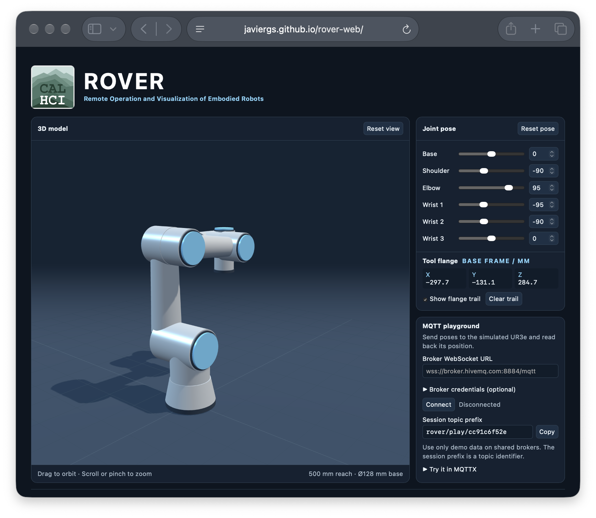

Project:
# Remote Operation and Visualization of Embodied Robots (ROVER)

Module:

## ROVER Web

Explore the Universal Robots UR3e in 3D, adjust its joint angles, and inspect the tool flange position.

[Open the live ROVER app](https://javiergs.github.io/rover-web/)

## Use the viewer

- Drag to orbit, scroll or pinch to zoom, and use **Reset view** to restore the camera.
- Use the sliders or type angles in degrees to inspect a pose. **Reset pose** restores the initial display pose.
- Read the tool flange center in millimetres in the robot’s Z-up base frame. The optional trail connects displayed flange positions.

## Try the MQTT playground

1. Enter your broker’s secure WebSocket URL (`wss://`) and any required credentials, then click **Connect**.
2. Copy the session topic prefix. In your MQTT client, subscribe to `<prefix>/pose/state`.
3. Publish a pose to `<prefix>/pose/set`, or send a request to `<prefix>/pose/get`.

| Topic suffix | Example JSON |
| --- | --- |
| `pose/set` | `{"j1":0,"j2":-1.57,"j3":1.66,"j4":-1.66,"j5":-1.57,"j6":0}` |
| `pose/get` | `{"requestId":"demo-1"}` |
| `pose/state` | `{"j1":0,"j2":0,"j3":0,"j4":0,"j5":0,"j6":0,"xyz":{"x":-456.75,"y":-223.15,"z":66.5},"requestId":"demo-1"}` |

Joint angles are in radians. The state message reports the simulated flange position in base-frame millimetres. ROVER publishes state after connecting, after pose changes, and in response to requests. Only a requested reply echoes the request ID. Publish messages without the retain flag.

Use demo data on shared brokers. Each page load generates a new topic prefix, and anyone with access to those topics can interact with the simulation.

## Other ROVER applications

[ROVER Desktop](https://github.com/javiergs/rover-desktop) provides an installable application for Universal Robots e-Series arms. It supports offline simulation and, when connected to URSim or a physical controller, real-time robot-state visualization and motion control. ROVER Web is a browser-based UR3e simulator with an MQTT playground; it does not require a robot connection.

## Safety

ROVER Web is an experimental **simulation**, not a robot controller. Its joint controls and MQTT playground change the simulated UR3e displayed in your browser. The app does not directly connect to or control a physical robot.

Treat public MQTT brokers as shared, untrusted spaces. A session topic prefix is **not** authentication; someone who knows it can send messages to your simulation. Use demo data only. Do not share credentials or sensitive robot/network information, and do not connect the demo topics to physical robot motion without independent validation and safety safeguards.

## Feedback

[Open an issue](https://github.com/javiergs/rover-web/issues/new/choose) to report a bug, suggest a feature, or flag unclear instructions.

For bugs, include your browser, operating system, whether MQTT was connected, steps to reproduce, what you expected, and what happened. Screenshots or sanitized browser-console messages are welcome; never post broker credentials.
